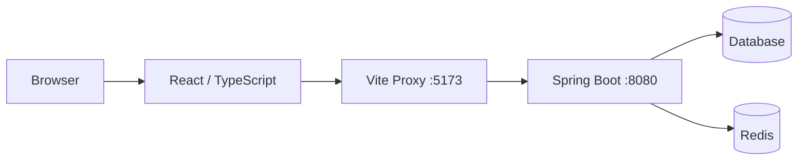

# Community Frontend

React와 TypeScript를 기반으로 구현한 커뮤니티 게시판 프론트엔드 프로젝트입니다.

Java 21과 Spring Boot 기반의 Community REST API와 연동하며, 컴포넌트 기반의 화면 구성, JWT 인증, 게시글 조회 및 작성, 사용자 입력 검증과 HTTP 응답 처리를 구현했습니다.

## Tech Stack

| 구분 | 기술 |
|---|---|
| Language | TypeScript |
| Frontend | React, HTML, CSS |
| Backend | Java 21, Spring Boot |
| Authentication | JWT |
| HTTP Client | Fetch API |
| Build Tool | Vite |
| Package Manager | npm |
| Code Quality | Oxlint |

## 주요 기능

### 게시글 조회

- 비로그인 상태에서 게시글 목록 조회
- 게시글별 본문 펼치기·접기
- 전체 게시글 수 표시
- 로딩·성공·실패 상태에 따른 화면 처리
- 조회 실패 시 재시도

### 인증 및 상태 관리

- JWT 기반 로그인
- Access Token 관리 및 Bearer 인증 요청
- 로그인 상태에 따른 화면 구성
- 인증 실패 및 재로그인 처리

### 게시글 작성

- 카테고리 조회 및 선택
- 제목 및 본문 입력값 검증
- 게시글 등록 및 목록 갱신
- 등록 실패 시 오류 안내 및 작성 내용 유지

## Architecture



React에서 발생한 API 요청은 개발환경의 Vite 프록시를 통해 Spring Boot 서버로 전달됩니다.

Spring Boot에서 반환한 JSON 응답은 React의 상태에 반영되며, 컴포넌트 단위로 화면을 구성합니다.

## Project Structure

```text
community-frontend/
├── src/
│   ├── components/
│   │   ├── PostCard.tsx
│   │   ├── LoginForm.tsx
│   │   └── PostComposer.tsx
│   ├── App.tsx
│   ├── main.tsx
│   ├── posts.ts
│   ├── postsApi.ts
│   ├── authApi.ts
│   ├── apiError.ts
│   ├── App.css
│   └── index.css
├── index.html
├── package.json
├── vite.config.ts
└── README.md
```

| 구분 | 주요 파일 | 역할 |
|---|---|---|
| Entry Point | main.tsx, index.html | 애플리케이션 진입점 |
| State Management | App.tsx | 로그인 및 게시글 목록 상태 관리 |
| Components | components/ | 게시글 카드, 로그인 및 작성 폼 |
| API | authApi.ts, postsApi.ts | HTTP 요청 및 응답 처리 |
| Type | posts.ts | 게시글 데이터 타입 정의 |
| Error Handling | apiError.ts | HTTP 오류 처리 |
| Style | App.css, index.css | 화면 스타일 관리 |
| Configuration | vite.config.ts, package.json | 개발환경 및 의존성 관리 |

## REST API

| Method | Endpoint | Description | Authentication |
|---|---|---|---|
| GET | /api/posts | 게시글 목록 조회 | Public |
| POST | /api/auth/login | 사용자 로그인 | Public |
| GET | /api/categories | 카테고리 조회 | Bearer Token 전달 |
| POST | /api/posts | 게시글 등록 | Bearer Token |

## Getting Started

### 1. Backend

기존 Community REST API 프로젝트를 실행합니다.

- Java 21
- Spring Boot
- H2 또는 MySQL
- Redis
- JWT_SECRET 환경 변수 설정

백엔드의 `local` 프로필은 H2를 사용하며, `docker` 프로필은 MySQL을 사용합니다.

보호 API를 사용하려면 Redis 연결이 필요합니다.

기본 실행 주소:

```text
http://127.0.0.1:8080
```

API 응답 확인:

```powershell
curl.exe -i http://127.0.0.1:8080/api/posts
```

### 2. Frontend

`package.json`이 있는 프로젝트 루트 디렉터리에서 실행합니다.

```bash
npm ci
npm run dev
```

기본 접속 주소:

```text
http://localhost:5173
```

### 3. API Proxy

기본 백엔드 연결 대상은 `http://127.0.0.1:8080`입니다.

백엔드의 실행 주소가 다른 경우 환경 변수를 통해 변경할 수 있습니다.

**Windows PowerShell**

```powershell
$env:COMMUNITY_API_TARGET = 'http://127.0.0.1:18080'
npm run dev
```

**macOS / Linux**

```bash
COMMUNITY_API_TARGET=http://127.0.0.1:18080 npm run dev
```

## Build & Lint

### Production Build

```bash
npm run build
```

TypeScript 타입 검사 및 Vite 프로덕션 빌드를 수행합니다. 빌드 결과물은 `dist/`에 생성됩니다.

### Static Analysis

```bash
npm run lint
```

Oxlint를 이용하여 코드의 정적 검사를 수행합니다.

## Verification

### 실제 서버 연동

| 검증 항목 | 결과 |
|---|---|
| Spring Boot 게시글 조회 API | HTTP 200 |
| Vite 프록시를 통한 API 요청 | HTTP 200 |
| Spring Boot 및 Vite JSON 응답 비교 | 일치 |
| React 브라우저 실행 | PASS |
| TypeScript 타입 검사 | PASS |
| Vite 프로덕션 빌드 | PASS |
| Oxlint 정적 검사 | PASS |

### 브라우저 기능 검증

| 검증 항목 | 결과 |
|---|---|
| 게시글 목록 표시 | PASS |
| 본문 펼치기·접기 | PASS |
| 로그인 및 인증 실패 처리 | PASS |
| 카테고리 조회 및 선택 | PASS |
| 게시글 작성 및 목록 갱신 | PASS |
| 입력값 검증 및 오류 처리 | PASS |
| 등록 실패 시 작성 내용 유지 | PASS |

인증 및 게시글 작성 관련 브라우저 검증은 테스트 응답(Fixture)을 기반으로 수행했습니다.

## Related Project

- **Community REST API** — Java / Spring Boot 기반 백엔드 프로젝트
- GitHub: https://github.com/ujo-orr/comunity-api